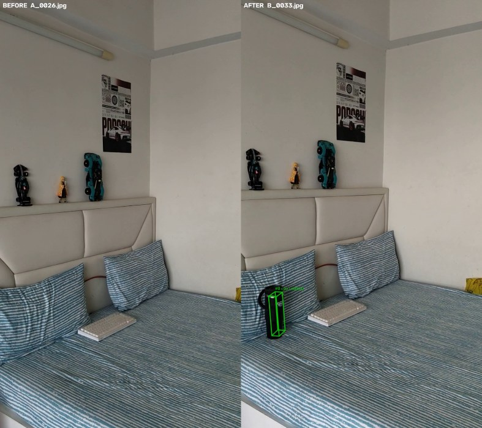
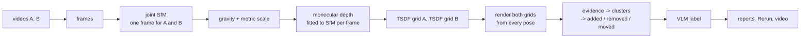

# What changed in the room?

Given two phone videos of the same indoor area, one recorded before and one after, this
finds which objects were **added**, **removed** or **moved**, where they are in 3-D, and what
they are. Differences that only come from a different viewpoint, occlusion or incomplete
coverage are kept as *unknown* rather than reported as changes.



*Bottle pair: a frame from video A (left) and the nearest B frame (right), with the detected
3-D box projected into it. Full output: [`examples/bottle/report.md`](examples/bottle/report.md).*

## Results on real recordings

Four pairs of handheld phone videos (Nothing A063), about 30 s each; the three below are in a bedroom.
"Ours" is the visibility-aware method; the baseline flags every fused point that has no
neighbour within 5 cm in the other recording, then clusters with the same code and settings.

| pair | what changed | frames registered (A / B) | reproj. error | ours | baseline |
|---|---|---|---|---|---|
| bottle | black bottle put on a pillow | 61/61, 65/65 | 0.98 px | **1 added**, at the bottle, 7 × 4 × 21 cm | 9 (8 false) |
| static | nothing (different camera path) | 75/75, 74/74 | 1.08 px | **0** | 4 false |
| keyboard | keyboard taken off the bed | 63/75, 53/64 | 1.04 px | 0 (missed) | 1 false |

Sources: `out/<pair>/sfm/sfm_report.json`, `out/<pair>/report.json`,
`out/<pair>/baseline/changes.json`; copies of the reports are in [`examples/`](examples).

- On the unchanged room the method reports nothing. The baseline's false alarms there come
  from surfaces that only one recording saw well; the visibility check classifies those as
  unknown.
- **The keyboard is a resolution limit, not a threshold problem.** Lying flat it is 2–3 cm
  tall, while the depth threshold is about 7.5 cm at the 1.5 m filming distance (5 % of depth,
  set by monocular depth noise). Sweeping the threshold down to 1.5 % on all three pairs never
  produced a keyboard cluster, and it added false positives on the static pair and lost the
  bottle (table in [DEVLOG.md](DEVLOG.md)), so the default stays.
- The label for the bottle is "cup" (confidence 0.8), and the model calls the bed a couch.
  The geometry is right; the 2B vision-language model is the weak part.
- A fourth pair (a ball on a glossy tiled floor) failed at reconstruction: 65 of 109 frames
  registered at 1.84 px. Reflections that move with the camera and a TV showing different
  pictures leave too little reliable texture. It is excluded rather than reported.

Hand-labelled ground truth for the real pairs is made with `eval/annotate.py` (see
[Evaluation](#evaluation)); scored precision/recall tables are produced once those labels exist.

### Synthetic room

`tests/make_synthetic_videos.py` renders a textured room with exact poses and known changes
(chair removed, box added, bin moved). From `eval/results/synth.md`:

| method | predictions | true positives (of 3) | precision | recall | centroid error |
|---|---|---|---|---|---|
| ours | 4 | 3 | 0.75 | 1.00 | 0.083 |
| baseline | 17 | 3 | 0.18 | 1.00 | 0.085 |

The one false positive is a small patch on a wall that passes the size filter; making the
size test work for small real objects such as the bottle let it through.

## How it works



1. **One coordinate frame by construction.** Frames from both videos go into a single
   structure-from-motion run (DISK features, LightGlue matching, pycolmap mapping), so A and
   B share a frame without any ICP between separate reconstructions. On the real pairs, 93 %
   or more of the 3-D points are observed from both videos.
2. **Gravity and scale.** RANSAC finds the dominant horizontal plane (the floor, or the bed
   when the floor is out of view) and makes it z = 0. Metric scale comes from the median ratio
   between a metric depth model and SfM depth over many frames, so it is approximate (the
   interquartile range of the per-frame ratios is 3-10 % of the median on the real pairs).
3. **Dense geometry per recording.** Depth Anything V2 depth is fitted to each frame's own SfM
   points with RANSAC and fused into one TSDF grid per recording. Rays are also used to mark
   empty space as observed.
4. **Visibility-aware comparison.** Both grids are rendered from every camera pose of A and
   B. Where B's surface is in front of A's, that is evidence for *added*; behind it, for
   *removed*. Evidence only counts if the other recording saw that spot as empty space;
   otherwise it is *unknown*. A voxel needs confirmation from three distinct viewpoints.
5. **Objects.** Evidence is clustered with DBSCAN. Thin sheets lying on a static surface,
   which is how depth error between the recordings shows up, are rejected. A removed and an
   added cluster with similar size and colours become one move with a displacement.
6. **Labels.** The best unoccluded before/after views are cropped and sent to Qwen2-VL-2B,
   which must return JSON matching a schema. The model is given no numbers; every size,
   position and displacement in the descriptions comes from the geometry.

### Design choices

- **Render against render, not raw depth maps.** Single-frame monocular depth is noisy;
  fusing first averages it, and both recordings are then compared from identical poses.
- **Unknown is never a change.** A removed object in front of a region the other recording
  never measured is missed rather than guessed. For a robot, a false "obstacle gone" is worse
  than a missed one.
- **Mesh ray casting instead of `VoxelBlockGrid.ray_cast`.** With open3d 0.20 on Windows,
  `ray_cast` hung for some settings and gave different hits on repeated calls for others.
  The grid's zero-level mesh is rendered with `RaycastingScene` instead.
- **Metric scale from depth, not camera height.** The first real pair never showed the floor;
  the "floor" plane was the mattress, which made a camera-height assumption 29 % off.
- **Sharpness relative to neighbouring frames.** A plain tiled floor scores about 50 on the
  Laplacian measure where a patterned sheet scores about 400, so a fixed blur threshold threw
  away 95 of 111 sharp frames.

## Install

Windows 11, Python 3.13, NVIDIA GPU with CUDA 12 (developed on an RTX 4050 Laptop, 6 GB).

```bash
python -m venv venv
venv\Scripts\pip install torch==2.6.0+cu124 torchvision==0.21.0+cu124 --index-url https://download.pytorch.org/whl/cu124
venv\Scripts\pip install -r requirements.txt     # exact versions: requirements.lock
```

DISK/LightGlue weights, Depth Anything V2 (relative and metric-indoor, small) and
Qwen2-VL-2B-Instruct (4.4 GB) are downloaded on first use into `.hf_cache/`.

## Run

```bash
python run.py --video_a before.mp4 --video_b after.mp4 --out out/room
python run.py --out out/room --stages diff,cluster,semantics,viz    # re-run the tail only
```

About 25 minutes for two 30-second videos on the laptop above, most of it exhaustive feature
matching. Outputs in `out/<name>/`:

| file | contents |
|---|---|
| `report.md`, `report.json` | every change: action, label, description, 3-D box, centroid, displacement, confidence, supporting views |
| `changes.rrd` | Rerun recording (`rerun out/<name>/changes.rrd`): both clouds, cameras, change boxes, unknown evidence in grey |
| `side_by_side.mp4` | B frames next to the closest A frame, change boxes projected in |
| `floor_map.png` | top-down map of obstacles, changes and both camera paths |

Recording tips that matter: walk sideways rather than turning on the spot, keep textured
furniture in view, avoid long stretches of blank wall or glossy floor, and keep screens off.

## Evaluation

```bash
# label each real change by clicking its centre in 2+ frames (triangulated from SfM poses only)
python eval/annotate.py --out out/bottle --scene bottle --action added --label bottle --epoch B
python eval/run_eval.py --gt eval/gt/bottle.json --out out/bottle
```

`run_eval.py` scores both methods: change-level precision and recall (the action must match
and the centroid lie within 0.3 m), region-level precision and recall, and centroid error.

## Tests

```bash
python -m pytest        # 43 tests
python -m ruff check .
```

They cover the pose and pixel conventions (including that Open3D's integration uses
COLMAP's pixel centres), depth fitting, fusion helpers, a synthetic scene with removed,
added, moved, occluded and never-observed objects, the ablation showing that the free-space
check is what suppresses the occlusion false positive, the VLM output validation, and the
annotation triangulation.

## Limitations

- Objects lower than about 5 cm lying on a surface (keyboards, books, rugs) are not detected,
  and flat objects against walls (posters) are rejected as sheets.
- Needs textured, mostly Lambertian scenes: glossy floors and screens broke reconstruction
  on one pair.
- A removed object in front of a region the other recording never measured stays unknown.
- Scale is approximate (median of monocular metric depth).
- People and pets are not masked and would show up as changes.
- Labels come from a 2B model running locally and are often generic; only the local backend
  is implemented.
- Open3D's Windows wheel is CPU-only, so fusion and rendering run on the CPU.

## Layout

```
run.py, config.yaml     entry point and every tunable
src/                    frames, sfm, alignment, depth(_align), fusion, diff, cluster,
                        baseline, semantics, viz, utils/geometry
tests/                  unit tests, synthetic renderer and change test, synthetic videos
eval/                   annotate.py (ground truth), run_eval.py, results/
examples/               reports from the real pairs
DEVLOG.md               dated log of runs, measurements, bugs and decisions
```
