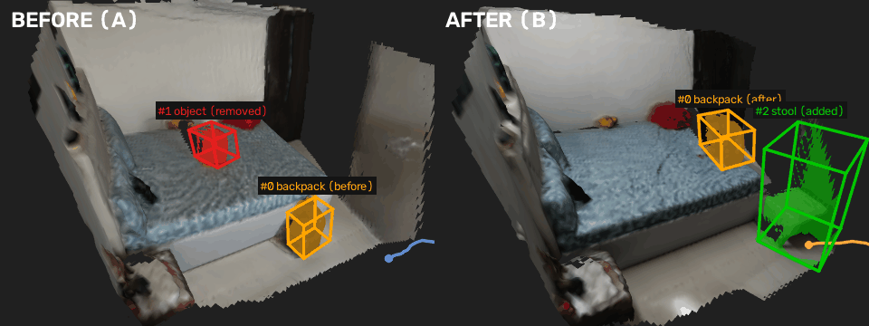
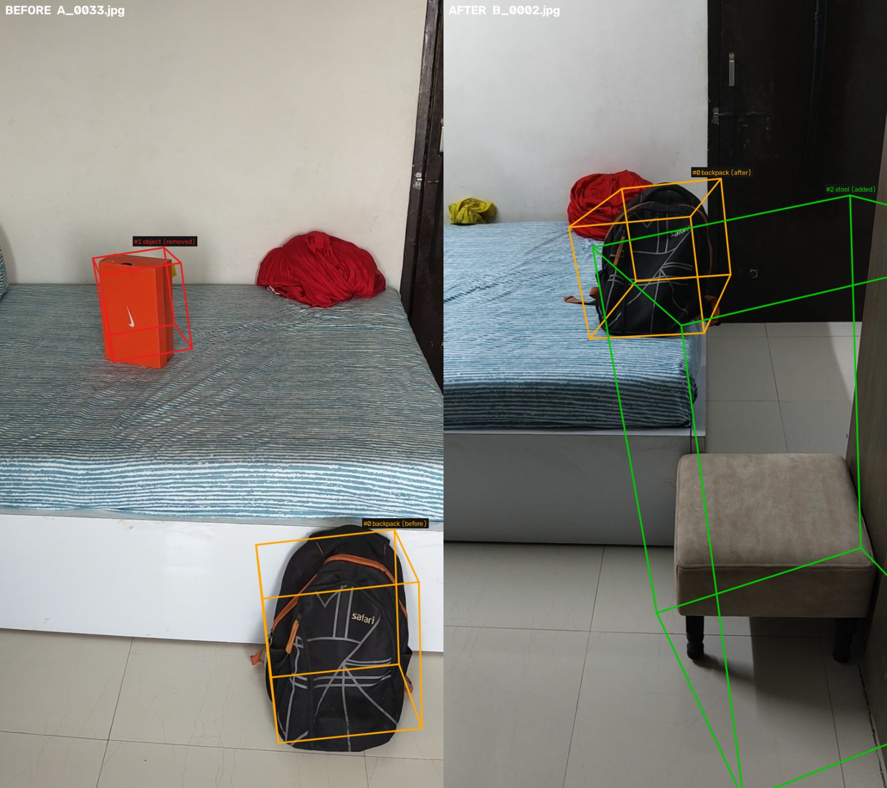
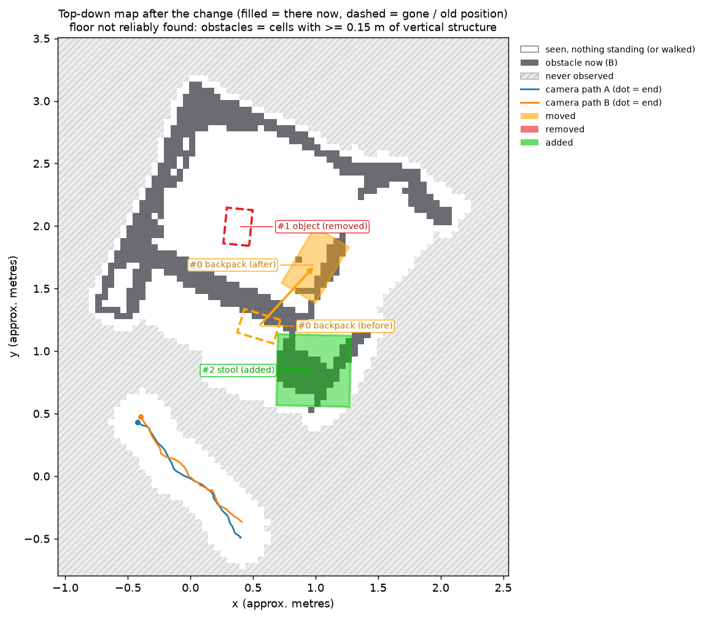
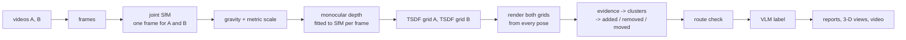

# What changed in the room?

[](https://github.com/yatrik-15/Humanoid-Challenge/actions/workflows/tests.yml) [](LICENSE)

Given two phone videos of the same indoor area, one recorded before and one after, this
finds which objects were **added**, **removed** or **moved**, where they are in 3-D, and what
they are. Differences that only come from a different viewpoint, occlusion or incomplete
coverage are kept as **unknown** rather than reported as changes, and the result is checked
against the path a robot would walk: if a change now blocks it, a new route is planned.



*Hero pair: both recordings fused into one 3-D frame and rendered from the same virtual
camera, left before, right after. All three kinds of change in one room, all three found and
nothing else reported: the backpack moved from the floor onto the bed (orange), the orange
shoebox was taken off the bed (red) and a stool was added (green). Every change is within
25 cm of where it was clicked by hand in the video frames. Full report:
[`examples/hero`](examples/hero).*

**Explore the results in 3-D in your browser, nothing to install:** [hero](https://app.rerun.io/version/0.39.0/?url=https://raw.githubusercontent.com/yatrik-15/Humanoid-Challenge/main/examples/hero/changes.rrd) · [bottle](https://app.rerun.io/version/0.39.0/?url=https://raw.githubusercontent.com/yatrik-15/Humanoid-Challenge/main/examples/bottle/changes.rrd) · [stool](https://app.rerun.io/version/0.39.0/?url=https://raw.githubusercontent.com/yatrik-15/Humanoid-Challenge/main/examples/stool/changes.rrd) · [walkway](https://app.rerun.io/version/0.39.0/?url=https://raw.githubusercontent.com/yatrik-15/Humanoid-Challenge/main/examples/walkway/changes.rrd) (Rerun web viewer). It opens on BEFORE and AFTER side by side: the reconstructed room surfaces, both camera paths and the change boxes, with the report alongside. Each file is under 2 MB (surfaces simplified to 40 k triangles per recording); set `viz.rerun_extras: true` to also include every camera frustum, the raw points and the unknown regions.

## Highlights

- **Unknown is never a change.** Both recordings are fused in 3-D and rendered from every
  camera pose of both; a difference only counts where the other recording actually saw
  empty space. On the six real pairs the same pipeline without this check reports 26
  changes, 7 of them real; with it, 9, 6 of them real. An unchanged room gives 0.
- **One 3-D frame by construction.** Both videos go into a single structure-from-motion
  run, so there is no registration step between two separate reconstructions to fail.
  Gravity comes from the floor plane, metric scale from a metric depth model.
- **Geometry decides, language only names.** What changed, where and how big comes from the
  3-D comparison; a vision-language model only names the object, never sees a number, and
  must answer in a validated JSON schema.
- **Built for a robot, not just a picture.** The route walked in the first video is replayed
  on the changed room; if a change blocks it, the blocker is named and a new route is planned
  through space that was actually observed. Both rooms are exported as standard ROS maps.
- **Measured against hand labels, including what fails.** Every real change was labelled by
  clicking it in the video frames ([Evaluation](#evaluation)); precision and recall are
  reported per pair for the method and the baseline, and every miss and false positive is
  explained below.

## Results on real recordings

Seven pairs of handheld phone videos (30-65 s each), plus a synthetic room with exact
ground truth. "Baseline" flags every fused point with no neighbour within 5 cm in the other
recording and clusters it with the same code and filters, i.e. the method without
visibility reasoning.

| pair | what changed | ours | baseline | notes |
|---|---|---|---|---|
| [hero](examples/hero) | backpack moved floor → bed, stool added, shoebox removed | **backpack moved 0.83 m** ✅, **shoebox removed** ✅, **stool added** ✅; 0 false | 5 (3 on real changes) | door closed; B recorded in evening light, A in daylight; heights unreliable (see Limitations) |
| [bottle](examples/bottle) | bottle put on a pillow | **1 added** ✅ "water bottle", 5 × 4 × 20 cm | 3 (2 false) | |
| [static](examples/static) | nothing (different camera path) | **0** ✅ | 1 (false) | negative control |
| [stool](examples/stool) | stool removed | **stool removed** ✅ "footstool", 0.5 × 0.6 × 0.5 m | 7 (1 on the stool) | run with `--known_focal_rel 1.64` |
| [walkway](examples/walkway) | bag moved, ball moved, bottle added | **bag moved 1.08 m** ✅, ball's old spot found (as removed); 2 false | 10 (2 on real changes) | false ones: a static vase and a window frame at a black night-time window; the ball's new spot and the bottle (a spot A never saw) are not found |
| [keyboard](examples/keyboard) | keyboard taken off the bed | 0 ❌ missed | 0 | 2-3 cm tall: below depth resolution |
| ball | ball on a glossy tiled floor | – | – | reconstruction failed (reflections, TV screen) |

**Scored against hand labels** (`eval/run_eval.py`; a change counts when the action matches
and its centre lies within 0.3 m of the labelled point; per-pair tables in
[`eval/results/`](eval/results)):

| pair | real changes | ours: reported / correct | baseline: reported / correct |
|---|---|---|---|
| hero | 3 | 3 / **3** | 5 / 3 |
| bottle | 1 | 1 / **1** | 3 / 1 |
| stool | 1 | 1 / **1** | 7 / 1 |
| walkway | 3 | 4 / 1 | 10 / **2** |
| keyboard | 1 | 0 / 0 | 0 / 0 |
| static | 0 | **0** / – | 1 / – |
| **all six** | **9** | **9 / 6: precision 0.67, recall 0.67** | 26 / 7: precision 0.27, recall 0.78 |

The baseline finds one more real change in total, on the walkway: its many fragments land
near both positions of the moved ball, while the method finds the ball's old spot but calls
it "removed" (its new spot was never confirmed), which this strict scoring counts as a
miss. It pays for that recall with 19 false reports against the method's 3.
Every number above comes from `examples/<pair>/report.json`, `eval/results/` and the run
logs; how each was measured, and what was tried and dropped, is in [DEVLOG.md](DEVLOG.md).

What this shows:

- **All three kinds of change are found on real data, in one recording**: in the hero pair
  the backpack's old and new positions are linked into one move, the shoebox taken off the
  bed is found as removed and the stool as added, with nothing else reported.

  

- **Viewpoint changes are not reported as changes.** On the unchanged room the method
  reports nothing. In the static pair B also filmed a doorway that A never saw (right
  edge), and it stays unknown, not "added":

  

- **What fails, and why.** A keyboard lying flat is 2-3 cm tall while the change threshold is
  about 7.5 cm at the 1.5 m filming distance (5 % of depth, set by monocular depth noise);
  lowering it down to 1.5 % never produced a keyboard cluster, added false positives on the
  static pair and lost the bottle. An object removed and another put down in exactly its
  place (an earlier hero recording: the backpack where the shoebox had stood) leaves that
  space occupied in both recordings, so only a thin sliver of the box remained as evidence
  and it was rejected as flat. Objects seen from one side only, pressed against a wall,
  look flat too and were rejected in two earlier recordings. Most false
  positives come from places where monocular depth is weakest: blank walls, a black
  night-time window, reflections in a glossy floor (rejected when they lie below the floor)
  and, in an earlier hero recording, the next room seen through an open door 3.5 m away.
  Evidence on a blank wall is a flat patch, while an object leaves a 3-D shell
  (front, sides, top); rejecting flat clusters removed 8 such false positives across the
  runs and no real change. Glossy floors with moving reflections break reconstruction
  altogether.

### For a robot: is my route still free?

A detected change matters to a robot when it is in the way. The route walked in recording A
is replayed on B's occupancy grid (robot radius 0.25 m). Route cells blocked only in B are
attributed to the change that blocks them, and A* plans around it if possible. The new
route may only use cells known to be traversable (floor seen in either recording, or walked
by the person filming): unobserved space is never assumed free, for the same reason unknown
is never a change. This is tested on a synthetic corridor with an added box: the blockage
is blamed on the box, and the new route goes around it, never through unobserved space.

On the real pairs the check ran on the walkway, where the floor is in view at a plausible
camera height. There the corridor between the bed and the wardrobe reconstructs narrower
than a 0.5 m wide robot, so most of the route is already blocked in A's own map and the
result says little. In the final hero recording the plane found lies 0.9 m below the
cameras, most likely the bed top, so the check is skipped rather than run on the wrong
surface. The top-down map still shows what is known (white: seen empty or walked, grey:
obstacle now, hatched: never observed) and the changes:



The check is skipped when the floor is not in view or the camera height above it is
implausible (outside 1.1-1.9 m); in the bedroom pairs the reference plane is the mattress.

The occupancy grids behind it are also written as standard ROS `map_server` maps
(`nav/map_A.pgm/.yaml` before, `nav/map_B.pgm/.yaml` after; 5 cm cells, occupied / free /
unknown, in the same metric frame as the report), so the after-map can be loaded directly by
a 2-D navigation stack such as Nav2: [`examples/walkway/nav/`](examples/walkway/nav).

### Synthetic room

`tests/make_synthetic_videos.py` renders a textured room with exact poses and known changes
(chair removed, box added, bin moved). From `eval/results/synth.md`:

| method | predictions | true positives (of 3) | precision | recall | centroid error |
|---|---|---|---|---|---|
| ours | 3 | 3 | 1.00 | 1.00 | 0.10 |
| baseline | 13 | 3 | 0.23 | 1.00 | 0.11 |

Camera poses are recovered to 1.4 mm (mean, after a similarity fit to the true poses).

## Quick start

Install (below), then run on a bundled pair:

```bash
python run.py --video_a examples/bottle/input/A.mp4 --video_b examples/bottle/input/B.mp4 --out out/bottle
```

30-45 minutes on a laptop RTX 4050 (measured: stool 43 min, walkway 33 min, hero 26 min), mostly feature
matching between every pair of frames. `sfm.match_pairs: windowed` matches each frame with
its 10 neighbours in the same video and with a third of the other video's frames: about 2x
faster (bottle 15 min), same bottle detection, but on the stool pair the metric scale came
out 17 % different, so it is an option, not the default. Results land in
`out/bottle/`; the copies in `examples/bottle/` came from exactly this command. The stool and
hero pairs were run with `--known_focal_rel 1.64` (see Design choices). Open the 3-D scene locally with
`rerun examples/bottle/changes.rrd`, or with the browser links at the top.

| output | contents |
|---|---|
| `report.md`, `report.json` | every change: action, label, description, 3-D box, centroid, displacement, label confidence, supporting viewpoints |
| `scene_3d.png`, `scene_3d.gif` | both reconstructed rooms from one virtual camera; the surface of each changed object is tinted (red removed, green added, orange moved), with boxes and camera paths (gif: orbit) |
| `side_by_side.mp4` | each B frame next to the closest A frame, change boxes projected in |
| `floor_map.png` | top-down map of the after-room: floor seen empty / obstacle / never observed, change footprints, move arrows, both camera paths, and the route check |
| `nav/route.json`, `nav/map_{A,B}.pgm/.yaml` | route check result and ROS `map_server` occupancy maps (only when the floor is in view) |
| `changes.rrd` | Rerun recording that opens on a BEFORE / AFTER layout: surface meshes, camera paths, change boxes, move arrows (frustums, points and evidence voxels with `viz.rerun_extras`) |

Re-run only the later stages after changing a setting:
`python run.py --out out/bottle --stages diff,cluster,semantics,viz`.

## How it works



1. **One coordinate frame by construction.** Frames from both videos go into a single
   structure-from-motion run (DISK features, LightGlue matching, pycolmap mapping), so A and
   B share a frame without any ICP between separate reconstructions. On the real pairs, 93 %
   or more of the 3-D points are observed from both videos.
2. **Gravity, scale and pose check.** RANSAC finds the dominant horizontal plane (the floor,
   or the bed when the floor is out of view) and makes it z = 0. Up comes from the camera x-axes, which
   stay level on a handheld phone even when it is pitched down. Metric scale is the median
   ratio between a metric depth model and SfM depth over many frames, so it is approximate.
   A frame whose camera position jumps away from both neighbours (registered in the wrong
   place) is dropped, and a recording whose camera moved less than 1 m triggers a warning.
3. **Dense geometry per recording.** Depth Anything V2 depth is fitted to each frame's own SfM
   points with RANSAC and fused into one TSDF grid per recording. Rays also mark the empty
   space in front of every surface as observed.
4. **Visibility-aware comparison.** Both grids are rendered from every camera pose of A and
   B. Where B's surface is in front of A's, that is evidence for *added*; behind it, for
   *removed*. Evidence only counts if the other recording saw that spot as empty space;
   otherwise it is *unknown*. A voxel needs confirmation from three distinct viewpoints.
5. **Objects.** Evidence voxels with few neighbours (thin lines along object outlines, where
   depth is least reliable) are dropped, then the rest is clustered with DBSCAN. Flat clusters lying on a static surface,
   which is how depth error between the recordings shows up, are rejected: an object's
   evidence is the 3-D shell the cameras saw, a depth error on a wall is a flat patch
   (smallest / middle principal variance below 0.15), and so are clusters lying entirely
   below the floor (reflections in a glossy floor). A removed and an
   added cluster with similar size and colours become one move with a displacement.
6. **Route check** (above).
7. **Labels.** The best unoccluded before/after views are cropped and sent to Qwen2-VL-2B,
   which must return JSON matching a schema. The model is given no numbers; every size,
   position and displacement in the descriptions comes from the geometry, and a summary that
   contains a number is discarded.

## Design choices and tradeoffs

- **Render against render, not raw depth maps.** Single-frame monocular depth is noisy;
  fusing first averages it, and both recordings are then compared from identical poses.
- **Unknown is never a change.** A removed object in front of a region the other recording
  never measured is missed rather than guessed. For a robot, a false "obstacle gone" is worse
  than a missed one. The cost is recall: the walkway bottle stood where A never looked.
- **Geometry decides, the language model only names.** Action, position and size never come
  from the VLM, so a wrong label cannot create or move a change. The cost is that a false
  change still gets a confident-sounding name.
- **A fixed focal length when self-calibration goes wrong.** On two pairs SfM settled on a
  focal length about 35 % too long with strong distortion, which flattened every depth map
  and hid the stool. `--known_focal_rel` (focal / image width; 1.64 for the phone used here)
  fixes it, and `sfm_report.json` warns when the solved distortion is implausible.
- **Mesh ray casting instead of `VoxelBlockGrid.ray_cast`.** With open3d 0.20 on Windows,
  `ray_cast` hung for some settings and returned different hits on repeated calls for
  others. The grid's zero-level mesh is rendered with `RaycastingScene` instead.
- **Drop frames registered in the wrong place.** One frame of an earlier hero recording sat 61 cm off
  the smooth path of its neighbours (they were 6 cm apart); its depth would be fused into
  the wrong part of the room. A frame further than 0.15 m from its neighbours' midpoint and
  more than twice their distance is dropped; across all eleven runs this flags only that
  frame, and the next most unusual frame is at a quarter of the threshold.
- **Nothing stands under the floor.** The floor plane is chosen so that almost no point lies
  below it, but a glossy floor mirrors the room and depth on those reflections lands
  beneath it. A cluster lying entirely more than 15 cm below the floor is dropped; across
  ten runs that removes two false detections (at a door, in two hero recordings) and no
  real change. It runs before move pairing, which had paired the added stool with one.
- **Cut thin bridges before clustering.** On an earlier hero recording a two-voxel-thin line of
  evidence along the bed's outline joined the added stool to the bed (a 1.9 m "stool").
  Dropping voxels with fewer than 8 neighbours within 5 cm separates them (stool box
  0.49 m) and changes nothing on the other pairs.
- **Thresholds chosen on these recordings, and where they break.** The flatness cut (0.15),
  the neighbour filter (8) and the size ratio for pairing a move (3.0, the backpack's two
  sightings differed 2.03x in volume) were set after looking at these pairs. Each was
  checked on every pair; the margins are recorded in DEVLOG.md (for example, 9 neighbours
  already loses the bottle).
- **Metric scale from depth, not camera height.** The first real pair never showed the floor;
  the "floor" plane was the mattress, which made a camera-height assumption 29 % off.
- **Sharpness relative to neighbouring frames.** A plain tiled floor scores about 50 on the
  Laplacian measure where a patterned sheet scores about 400, so a fixed blur threshold threw
  away 95 of 111 sharp frames.
- **Tried and dropped: an image-text check of the labels.** SigLIP scored each label on the
  view with the object against the view without it. On the stool pair, before the flatness
  filter existed, it flagged both wall patches that were then reported as changes; on the
  walkway pair it endorsed three false changes, because the two views come from different
  positions and a static vase entered only one crop. It is left in the code, off by default
  (`semantics.label_check`); the flatness filter now removes the wall patches by geometry.

## Install

Windows 11, Python 3.13, NVIDIA GPU with CUDA 12 (developed on an RTX 4050 Laptop, 6 GB).

```bash
python -m venv venv
venv\Scripts\pip install torch==2.6.0+cu124 torchvision==0.21.0+cu124 --index-url https://download.pytorch.org/whl/cu124
venv\Scripts\pip install -r requirements.txt     # exact versions: requirements.lock
```

DISK/LightGlue weights, Depth Anything V2 (relative and metric-indoor, small) and
Qwen2-VL-2B-Instruct (4.4 GB) are downloaded on first use into `.hf_cache/`.

Recording tips that matter: walk sideways rather than turning on the spot (the run warns
when a recording's camera moved less than 1 m: objects are then seen from too few
viewpoints to be confirmed), film objects from more than one side, keep textured furniture
and some floor in view, avoid long stretches of blank wall, glossy floor or a dark window,
and keep screens off.

## Evaluation

```bash
# label each real change by clicking the same point on it in 2+ frames
python eval/annotate.py --out out/ex_bottle --scene bottle --action added --label bottle --epoch B
python eval/run_eval.py --gt eval/gt/bottle.json --out out/ex_bottle
```

Every real change in the six scored pairs was labelled this way (`eval/gt/`). The clicked
point is triangulated from the camera poses alone, so the labels never see the detector's
output. When the clicked views are nearly parallel (under 5 degrees apart, as in the
short-baseline bedroom pairs), triangulation cannot fix the distance along the rays; the
point is then taken where each click ray meets that recording's reconstructed surface, and
the label records which method was used. Clicks that disagree by more than 15 px are
refused.

`run_eval.py` scores both methods: change-level precision and recall (the action must match
and the centroid lie within 0.3 m), region-level precision and recall, and centroid error.
Results: [`eval/results/`](eval/results) and the table under Results.

## Tests

```bash
python -m pytest        # 64 tests
python -m ruff check .
```

They also run on every push (GitHub Actions, Ubuntu, CPU only: the tests need no GPU and no
model weights).

They cover the pose and pixel conventions (including that Open3D's integration uses
COLMAP's pixel centres), depth fitting, fusion helpers, a synthetic scene with removed,
added, moved, occluded and never-observed objects, the ablation showing that the free-space
check is what suppresses the occlusion false positive, the VLM output validation, the
annotation triangulation, the route check (a blocked corridor is blamed on the added box and
replanned around it, never through unobserved space), the ROS map export and the mesh renderer.

## Limitations

- Objects lower than about 5 cm lying on a surface (keyboards, books, rugs) are not detected,
  and flat objects against walls (posters) are rejected as sheets.
- Needs textured, mostly Lambertian scenes: dark windows still cause false positives,
  glossy floors and screens broke reconstruction on one pair. The flatness cut was chosen
  on these recordings (real changes 0.17-0.80, false patches 0.06-0.13); an object seen
  from one side only would look flat and be rejected.
- A removed object in front of a region the other recording never measured stays unknown.
- Scale is approximate (median of monocular metric depth), and heights are unreliable on
  some pairs: in the hero recordings the plane found was tilted or was the bed top (an
  earlier recording measured the 45 cm bed top at 0.2-0.25 m). Positions on the floor plan
  agree with the hand labels to within 25 cm (hero: 7-25 cm).
- An object put down where another was removed hides the removal, and an object seen from
  one side only (against a wall) is rejected as flat; both happened in earlier hero
  recordings, and the final one avoids them by where things were placed.
- A next room seen through an open door, 3.5 m away, produced false removals in an earlier
  hero recording (depth is least accurate there); the final recording keeps the door shut.
- People and pets are not masked and would show up as changes.
- Labels come from a 2B model running locally and are sometimes generic or wrong.
- Open3D's Windows wheel is CPU-only, so fusion and rendering run on the CPU.

## Layout

```
run.py, config.yaml     entry point and every tunable
src/                    frames, sfm, pairs, alignment, depth(_align), fusion, diff, cluster,
                        navigation, baseline, semantics, utils/geometry
src/viz/                report, images, floor_map, render (3-D overview), rerun_export
tests/                  unit tests, synthetic renderer and change test, synthetic videos
eval/                   annotate.py (ground truth), run_eval.py, results/
examples/<pair>/        input videos (bottle, stool, walkway) and every output of the run
DEVLOG.md               dated log of runs, measurements, bugs and decisions
```

## License

MIT, see [LICENSE](LICENSE). The models downloaded at run time (DISK, LightGlue, Depth
Anything V2, Qwen2-VL) come with their own licenses.
