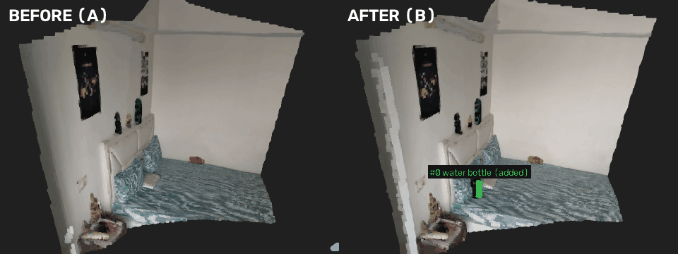
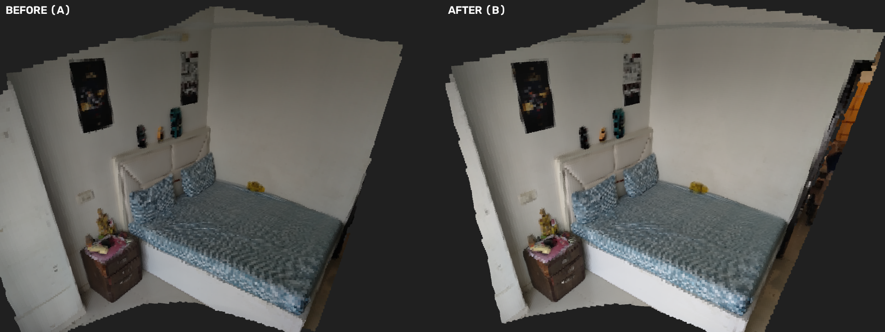
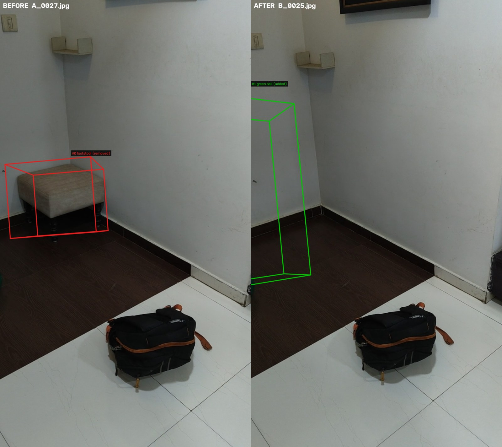
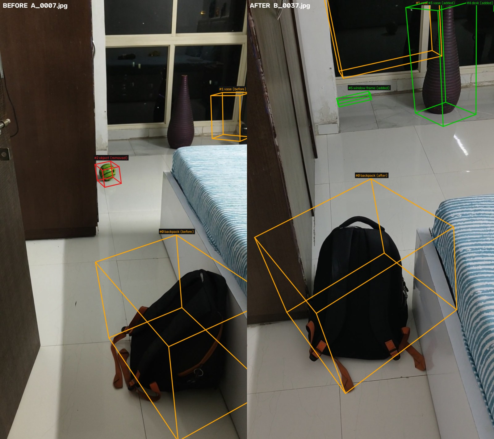
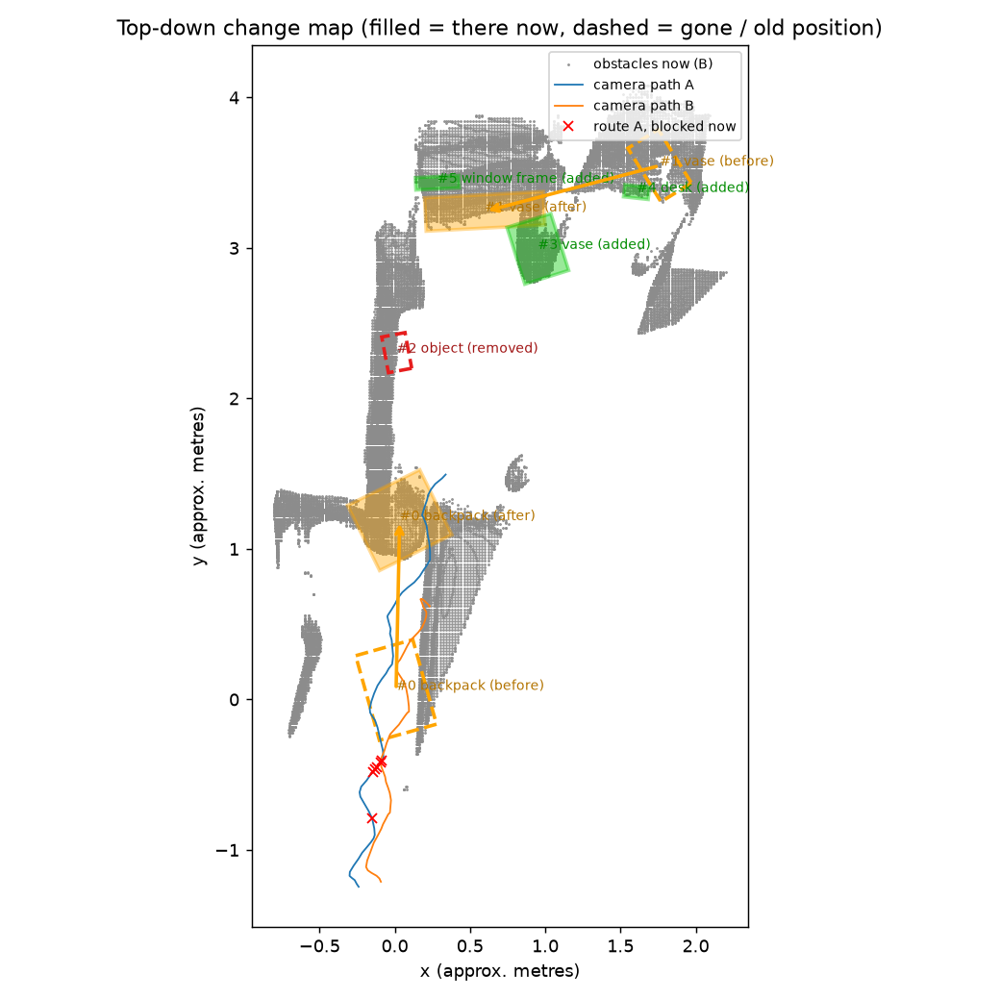
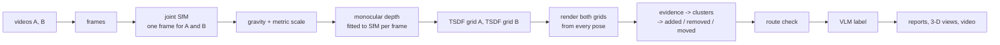

# What changed in the room?

Given two phone videos of the same indoor area, one recorded before and one after, this
finds which objects were **added**, **removed** or **moved**, where they are in 3-D, and what
they are. Differences that only come from a different viewpoint, occlusion or incomplete
coverage are kept as **unknown** rather than reported as changes, and the result is checked
against the path a robot would walk: if a change now blocks it, a new route is planned.



*Bottle pair: both recordings fused into one 3-D frame and rendered from the same virtual
camera. Left: before. Right: after, with the added bottle boxed in green. The full report is
[`examples/bottle/report.md`](examples/bottle/report.md).*

**Explore the results in 3-D in your browser, nothing to install:** [bottle](https://app.rerun.io/version/0.39.0/?url=https://raw.githubusercontent.com/yatrik-15/Humanoid-Challenge/main/examples/bottle/changes.rrd) · [stool](https://app.rerun.io/version/0.39.0/?url=https://raw.githubusercontent.com/yatrik-15/Humanoid-Challenge/main/examples/stool/changes.rrd) · [walkway](https://app.rerun.io/version/0.39.0/?url=https://raw.githubusercontent.com/yatrik-15/Humanoid-Challenge/main/examples/walkway/changes.rrd) (Rerun web viewer; both clouds, all camera poses, change boxes and the unknown regions in grey).

## Results on real recordings

Six pairs of handheld phone videos (about 30 s each), plus a synthetic room with exact
ground truth. "Baseline" flags every fused point with no neighbour within 5 cm in the other
recording and clusters it with the same code, i.e. the method without visibility reasoning.

| pair | what changed | ours | baseline | notes |
|---|---|---|---|---|
| [bottle](examples/bottle) | bottle put on a pillow | **1 added** ✅ "water bottle", 5 × 4 × 20 cm | 6 (5 false) | |
| [static](examples/static) | nothing (different camera path) | **0** ✅ | 4 (all false) | negative control |
| [stool](examples/stool) | stool removed | **stool removed** ✅ "footstool", 0.5 × 0.6 × 0.5 m; 1 false | 5 (stool split into 4 pieces, 1 false) | the false one is a blank white wall; run with `--known_focal_rel 1.64` |
| [walkway](examples/walkway) | bag moved, ball moved, bottle added | **bag moved 1.13 m** ✅, ball's old spot ✅ (as removed); 4 false | 20 (7 on real changes) | false ones at a dark window at night; the ball's new spot and the bottle (a spot A never saw) are not found |
| [keyboard](examples/keyboard) | keyboard taken off the bed | 0 ❌ missed | 1 (false) | 2–3 cm tall: below depth resolution |
| ball | ball on a glossy tiled floor | – | – | reconstruction failed (reflections, TV screen) |

Every number above comes from `examples/<pair>/report.json` and the run logs; how each was
measured, and what was tried and dropped, is in [DEVLOG.md](DEVLOG.md).

What this shows:

- **Viewpoint changes are not reported as changes.** On the unchanged room the method
  reports nothing, while the baseline reports four objects. They are surfaces that only one
  recording saw well; the visibility check classifies them as unknown. In the static pair B
  also filmed a doorway that A never saw (right edge), and it stays unknown, not "added":

  

- **All three kinds of change are found on real data**: an added bottle, a removed stool and
  a moved bag.

  | stool removed | bag moved |
  |---|---|
  |  |  |

- **What fails, and why.** A keyboard lying flat is 2–3 cm tall while the change threshold is
  about 7.5 cm at the 1.5 m filming distance (5 % of depth, set by monocular depth noise);
  lowering it down to 1.5 % never produced a keyboard cluster, added false positives on the
  static pair and lost the bottle. Blank walls and a dark window at night produce most false
  positives: monocular depth places textureless surfaces slightly differently from each
  viewpoint. Glossy floors with moving reflections break reconstruction altogether.

### For a robot: is my route still free?

A detected change matters to a robot when it is in the way. The route walked in recording A
is replayed on B's occupancy grid (robot radius 0.25 m). Route cells blocked only in B are
attributed to the change that blocks them, and A* plans around it if possible. The new
route may only use cells known to be traversable (floor seen in either recording, or walked
by the person filming): unobserved space is never assumed free, for the same reason unknown
is never a change. This is tested on a synthetic corridor with an added box: the blockage
is blamed on the box, and the new route goes around it, never through unobserved space.

On the walkway pair the check runs but says little: the corridor between the bed and the
wardrobe reconstructs narrower than a 0.5 m wide robot, so most of the route is already

blocked in A's own map, and the few remaining cells decide the result (an earlier run of the
same pair blamed the bag; the shipped run does not). The top-down map still shows the bag's
move across the walkway and both camera paths:



The check only runs when the floor is in view and the camera height above it is plausible
(1.1–1.9 m); in the bedroom pairs the reference plane is the mattress, so it is skipped.

The occupancy grids behind it are also written as standard ROS `map_server` maps
(`nav/map_A.pgm/.yaml` before, `nav/map_B.pgm/.yaml` after; 5 cm cells, occupied / free /
unknown, in the same metric frame as the report), so the after-map can be loaded directly by
a 2-D navigation stack such as Nav2: [`examples/walkway/nav/`](examples/walkway/nav).

### Synthetic room

`tests/make_synthetic_videos.py` renders a textured room with exact poses and known changes
(chair removed, box added, bin moved). From `eval/results/synth.md`:

| method | predictions | true positives (of 3) | precision | recall | centroid error |
|---|---|---|---|---|---|
| ours | 4 | 3 | 0.75 | 1.00 | 0.083 |
| baseline | 17 | 3 | 0.18 | 1.00 | 0.085 |

Camera poses are recovered to 1.4 mm (mean, after a similarity fit to the true poses).

## Quick start

Install (below), then run on a bundled pair:

```bash
python run.py --video_a examples/bottle/input/A.mp4 --video_b examples/bottle/input/B.mp4 --out out/bottle
```

About 25 minutes on a laptop RTX 4050, mostly exhaustive feature matching. Results land in
`out/bottle/`; the copies in `examples/bottle/` came from exactly this command. The stool pair
needs `--known_focal_rel 1.64` (see Design choices). Open the 3-D scene locally with
`rerun examples/bottle/changes.rrd`, or with the browser links at the top.

| output | contents |
|---|---|
| `report.md`, `report.json` | every change: action, label, description, 3-D box, centroid, displacement, label confidence, supporting viewpoints |
| `scene_3d.png`, `scene_3d.gif` | both fused recordings from one virtual camera, change boxes and camera paths (gif: orbit) |
| `side_by_side.mp4` | each B frame next to the closest A frame, change boxes projected in |
| `floor_map.png` | top-down map of obstacles, changes, both camera paths, and the route check |
| `nav/route.json`, `nav/map_{A,B}.pgm/.yaml` | route check result and ROS `map_server` occupancy maps (only when the floor is in view) |
| `changes.rrd` | Rerun recording: both clouds, cameras, change boxes, unknown evidence in grey |

Re-run only the later stages after changing a setting:
`python run.py --out out/bottle --stages diff,cluster,semantics,viz`.

## How it works



1. **One coordinate frame by construction.** Frames from both videos go into a single
   structure-from-motion run (DISK features, LightGlue matching, pycolmap mapping), so A and
   B share a frame without any ICP between separate reconstructions. On the real pairs, 93 %
   or more of the 3-D points are observed from both videos.
2. **Gravity and scale.** RANSAC finds the dominant horizontal plane (the floor, or the bed
   when the floor is out of view) and makes it z = 0. Up comes from the camera x-axes, which
   stay level on a handheld phone even when it is pitched down. Metric scale is the median
   ratio between a metric depth model and SfM depth over many frames, so it is approximate.
3. **Dense geometry per recording.** Depth Anything V2 depth is fitted to each frame's own SfM
   points with RANSAC and fused into one TSDF grid per recording. Rays also mark the empty
   space in front of every surface as observed.
4. **Visibility-aware comparison.** Both grids are rendered from every camera pose of A and
   B. Where B's surface is in front of A's, that is evidence for *added*; behind it, for
   *removed*. Evidence only counts if the other recording saw that spot as empty space;
   otherwise it is *unknown*. A voxel needs confirmation from three distinct viewpoints.
5. **Objects.** Evidence is clustered with DBSCAN. Thin sheets lying on a static surface,
   which is how depth error between the recordings shows up, are rejected. A removed and an
   added cluster with similar size and colours become one move with a displacement.
6. **Route check** (above).
7. **Labels.** The best unoccluded before/after views are cropped and sent to Qwen2-VL-2B,
   which must return JSON matching a schema. The model is given no numbers; every size,
   position and displacement in the descriptions comes from the geometry, and a summary that
   contains a number is discarded.

## Design choices and tradeoffs

- **Render against render, not raw depth maps.** Single-frame monocular depth is noisy;
  fusing first averages it, and both recordings are then compared from identical poses.
- **Unknown is never a change.** A removed object in front of a region the other recording
  never measured is missed rather than guessed. For a robot, a false "obstacle gone" is worse
  than a missed one. The cost is recall: the walkway bottle stood where A never looked.
- **Geometry decides, the language model only names.** Action, position and size never come
  from the VLM, so a wrong label cannot create or move a change. The cost is that a false
  change still gets a confident-sounding name.
- **A fixed focal length when self-calibration goes wrong.** On two pairs SfM settled on a
  focal length about 35 % too long with strong distortion, which flattened every depth map
  and hid the stool. `--known_focal_rel` (focal / image width; 1.64 for the phone used here)
  fixes it, and `sfm_report.json` warns when the solved distortion is implausible.
- **Mesh ray casting instead of `VoxelBlockGrid.ray_cast`.** With open3d 0.20 on Windows,
  `ray_cast` hung for some settings and returned different hits on repeated calls for
  others. The grid's zero-level mesh is rendered with `RaycastingScene` instead.
- **Metric scale from depth, not camera height.** The first real pair never showed the floor;
  the "floor" plane was the mattress, which made a camera-height assumption 29 % off.
- **Sharpness relative to neighbouring frames.** A plain tiled floor scores about 50 on the
  Laplacian measure where a patterned sheet scores about 400, so a fixed blur threshold threw
  away 95 of 111 sharp frames.
- **Tried and dropped: an image-text check of the labels.** SigLIP scored each label on the
  view with the object against the view without it. It flagged both false changes on the
  stool pair, but on the walkway pair it endorsed three false ones, because the two views come
  from different positions and a static vase entered only one crop. It is left in the code,
  off by default (`semantics.label_check`).

## Install

Windows 11, Python 3.13, NVIDIA GPU with CUDA 12 (developed on an RTX 4050 Laptop, 6 GB).

```bash
python -m venv venv
venv\Scripts\pip install torch==2.6.0+cu124 torchvision==0.21.0+cu124 --index-url https://download.pytorch.org/whl/cu124
venv\Scripts\pip install -r requirements.txt     # exact versions: requirements.lock
```

DISK/LightGlue weights, Depth Anything V2 (relative and metric-indoor, small) and
Qwen2-VL-2B-Instruct (4.4 GB) are downloaded on first use into `.hf_cache/`.

Recording tips that matter: walk sideways rather than turning on the spot, keep textured
furniture in view, avoid long stretches of blank wall or glossy floor, and keep screens off.

## Evaluation

```bash
# label each real change by clicking its centre in 2+ frames (triangulated from SfM poses only)
python eval/annotate.py --out out/bottle --scene bottle --action added --label bottle --epoch B
python eval/run_eval.py --gt eval/gt/bottle.json --out out/bottle
```

`run_eval.py` scores both methods: change-level precision and recall (the action must match
and the centroid lie within 0.3 m), region-level precision and recall, and centroid error.

## Tests

```bash
python -m pytest        # 52 tests
python -m ruff check .
```

They cover the pose and pixel conventions (including that Open3D's integration uses
COLMAP's pixel centres), depth fitting, fusion helpers, a synthetic scene with removed,
added, moved, occluded and never-observed objects, the ablation showing that the free-space
check is what suppresses the occlusion false positive, the VLM output validation, the
annotation triangulation, the route check (a blocked corridor is blamed on the added box and
replanned around it), the ROS map export and the point renderer.

## Limitations

- Objects lower than about 5 cm lying on a surface (keyboards, books, rugs) are not detected,
  and flat objects against walls (posters) are rejected as sheets.
- Needs textured, mostly Lambertian scenes: blank walls and dark windows cause false
  positives, glossy floors and screens broke reconstruction on one pair.
- A removed object in front of a region the other recording never measured stays unknown.
- Scale is approximate (median of monocular metric depth); heights are unreliable when the
  phone was rolled.
- People and pets are not masked and would show up as changes.
- Labels come from a 2B model running locally and are sometimes generic or wrong.
- Open3D's Windows wheel is CPU-only, so fusion and rendering run on the CPU.

## Layout

```
run.py, config.yaml     entry point and every tunable
src/                    frames, sfm, alignment, depth(_align), fusion, diff, cluster,
                        navigation, baseline, semantics, viz, utils/geometry
tests/                  unit tests, synthetic renderer and change test, synthetic videos
eval/                   annotate.py (ground truth), run_eval.py, results/
examples/<pair>/        input videos (bottle, stool, walkway) and every output of the run
DEVLOG.md               dated log of runs, measurements, bugs and decisions
```
