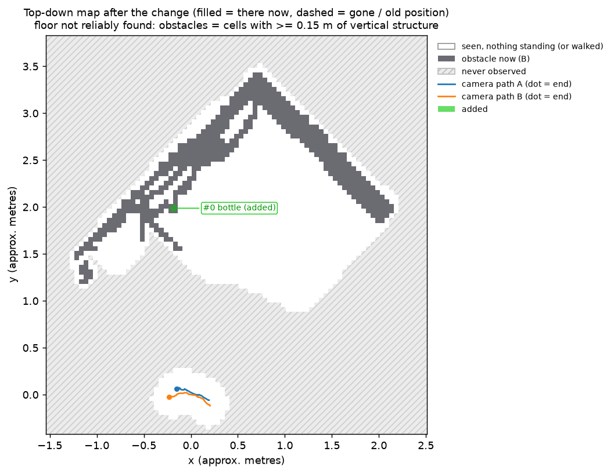

# What changed in the room

Units: **approx. metres** (scale from monocular metric depth (median over frames)). World frame: +z up; z=0 is the dominant horizontal support plane found by RANSAC (the floor, or a bed/table top when the floor is not visible).

Detected: **0 moved, 0 removed, 1 added**. Regions observed in only one recording are reported as UNKNOWN (296 evidence voxels), never as changes.

| id | action | object | label conf. | where (centroid x, y, z) | size / displacement | view groups |
|---|---|---|---|---|---|---|
| 0 | added | bottle | 0.80 | (-0.18, 1.99, 0.17) | 0.05 x 0.04 x 0.17 | 4 |

## Descriptions

- **#0 added — bottle**: Bottle added: An object was added (present only in the after recording). Region: centre at x=-0.18, y=1.99 m (approx.); size about 0.05 x 0.04 x 0.17 m (approx.) (top 0.26 m (approx.) above the z=0 plane). The bottle is on the floor, near the empty space.

## Visuals

Both recordings fused in 3-D, seen from one virtual camera (left before, right after):

Best before / after view of the first change, with every change box projected in:

Top-down map (filled = there now, dashed = gone or old position):

Interactive 3-D in the browser: [open in the Rerun web viewer](https://app.rerun.io/version/0.39.0/?url=https://raw.githubusercontent.com/yatrik-15/Humanoid-Challenge/main/examples/bottle/changes.rrd), or locally `rerun changes.rrd`.

Input videos: [`input/A.mp4`](input/A.mp4) (before), [`input/B.mp4`](input/B.mp4) (after).
