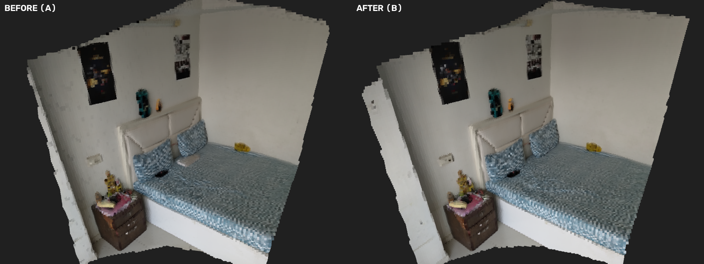
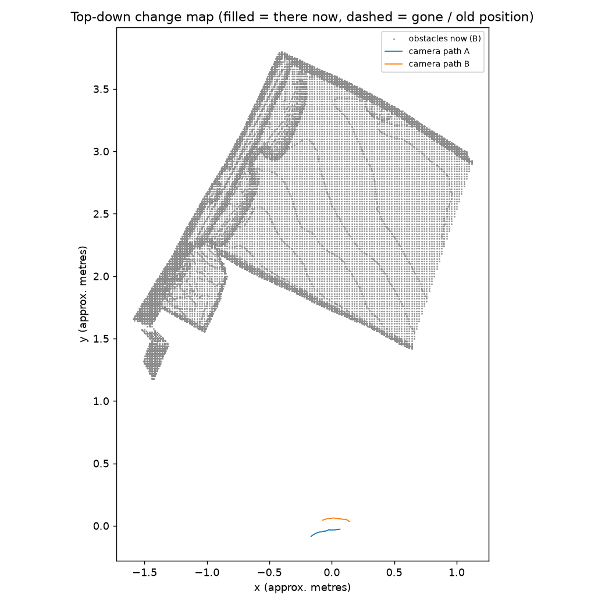

# What changed in the room

Units: **approx. metres** (APPROXIMATE metres from monocular metric depth (median over frames)). World frame: gravity from camera-up (no floor plane found).

Detected: **0 moved, 0 removed, 0 added**. Regions observed in only one recording are reported as UNKNOWN (66 evidence voxels), never as changes.

| id | action | object | label conf. | where (centroid x, y, z) | size / displacement | view groups |
|---|---|---|---|---|---|---|

## Descriptions

## Visuals

Both recordings fused in 3-D, seen from one virtual camera (left before, right after):

Top-down map (filled = there now, dashed = gone or old position):

The input videos of this pair are not included (size); the outputs above come from them.
