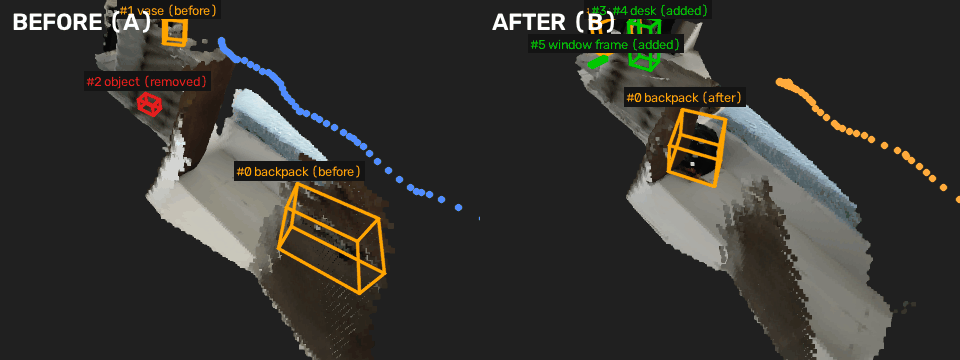

# What changed in the room

Units: **approx. metres** (APPROXIMATE metres from monocular metric depth (median over frames)). World frame: +z up; z=0 is the dominant horizontal support plane found by RANSAC (the floor, or a bed/table top when the floor is not visible).

Detected: **2 moved, 1 removed, 3 added**. Regions observed in only one recording are reported as UNKNOWN (2557 evidence voxels), never as changes.

| id | action | object | label conf. | where (centroid x, y, z) | size / displacement | view groups |
|---|---|---|---|---|---|---|
| 0 | moved | backpack | 0.80 | (0.01, 0.06, 0.19) → (0.03, 1.19, 0.27) | moved 1.13 | 13 |
| 1 | moved | vase | 0.80 | (1.76, 3.55, 0.25) → (0.60, 3.24, 0.75) | moved 1.30 | 16 |
| 2 | removed | label_unavailable | 0.00 | (0.01, 2.30, 0.15) | 0.24 x 0.16 x 0.16 | 32 |
| 3 | added | vase | 0.80 | (0.95, 2.99, 0.47) | 0.40 x 0.31 x 0.78 | 31 |
| 4 | added | desk | 0.80 | (1.61, 3.37, 0.71) | 0.16 x 0.08 x 0.08 | 14 |
| 5 | added | window frame | 0.80 | (0.28, 3.43, 0.20) | 0.29 x 0.08 x 0.05 | 18 |

## Descriptions

- **#0 moved — backpack**: Backpack moved: An object moved. Before: centre at x=0.01, y=0.06 m (approx.); size about 0.58 x 0.39 x 0.40 m (approx.) (top 0.39 m (approx.) above the z=0 plane). After: centre at x=0.03, y=1.19 m (approx.); size about 0.54 x 0.48 x 0.42 m (approx.) (top 0.48 m (approx.) above the z=0 plane). Displacement 1.13 m (approx.) (dx=+0.02, dy=+1.13, dz=+0.08). The backpack is now placed on the floor next to the bed.
- **#1 moved — vase**: Vase moved: An object moved. Before: centre at x=1.76, y=3.55 m (approx.); size about 0.42 x 0.24 x 0.54 m (approx.) (top 0.52 m (approx.) above the z=0 plane). After: centre at x=0.60, y=3.24 m (approx.); size about 0.79 x 0.22 x 0.53 m (approx.) (top 1.02 m (approx.) above the z=0 plane). Displacement 1.30 m (approx.) (dx=-1.16, dy=-0.30, dz=+0.50). The vase is now placed on the floor, replacing the previous location where it was standing on the window sill.
- **#2 removed — label_unavailable**: An object was removed (present only in the before recording). Region: centre at x=0.01, y=2.30 m (approx.); size about 0.24 x 0.16 x 0.16 m (approx.) (top 0.23 m (approx.) above the z=0 plane). (no valid semantic label)
- **#3 added — vase**: Vase added: An object was added (present only in the after recording). Region: centre at x=0.95, y=2.99 m (approx.); size about 0.40 x 0.31 x 0.78 m (approx.) (top 0.87 m (approx.) above the z=0 plane). The vase is on the floor, near the window, and is in front of the window.
- **#4 added — desk**: Desk added: An object was added (present only in the after recording). Region: centre at x=1.61, y=3.37 m (approx.); size about 0.16 x 0.08 x 0.08 m (approx.) (top 0.75 m (approx.) above the z=0 plane). The desk is in the middle of the room, near the window.
- **#5 added — window frame**: Window frame added: An object was added (present only in the after recording). Region: centre at x=0.28, y=3.43 m (approx.); size about 0.29 x 0.08 x 0.05 m (approx.) (top 0.23 m (approx.) above the z=0 plane). The window frame is located at the top of the image, adjacent to the empty space.

## Visuals

Both recordings fused in 3-D, seen from one virtual camera (left before, right after):

Best before / after view of the first change, with every change box projected in:

Top-down map (filled = there now, dashed = gone or old position):

Interactive 3-D in the browser: [open in the Rerun web viewer](https://app.rerun.io/version/0.39.0/?url=https://raw.githubusercontent.com/yatrik-15/Humanoid-Challenge/main/examples/walkway/changes.rrd), or locally `rerun changes.rrd`.

Route check and ROS `map_server` occupancy maps (before / after): [`nav/`](nav).

Input videos: [`input/A.mp4`](input/A.mp4) (before), [`input/B.mp4`](input/B.mp4) (after).
